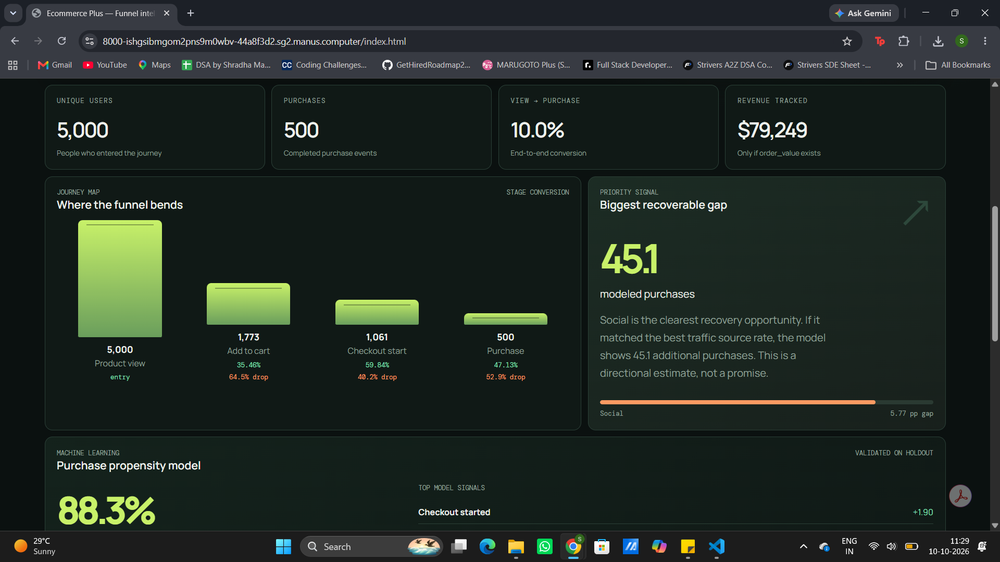
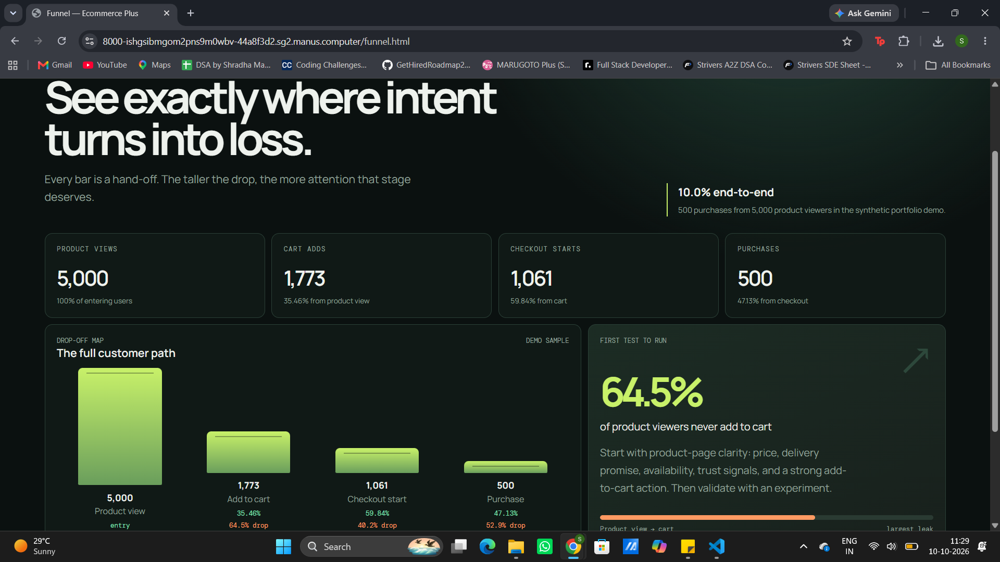
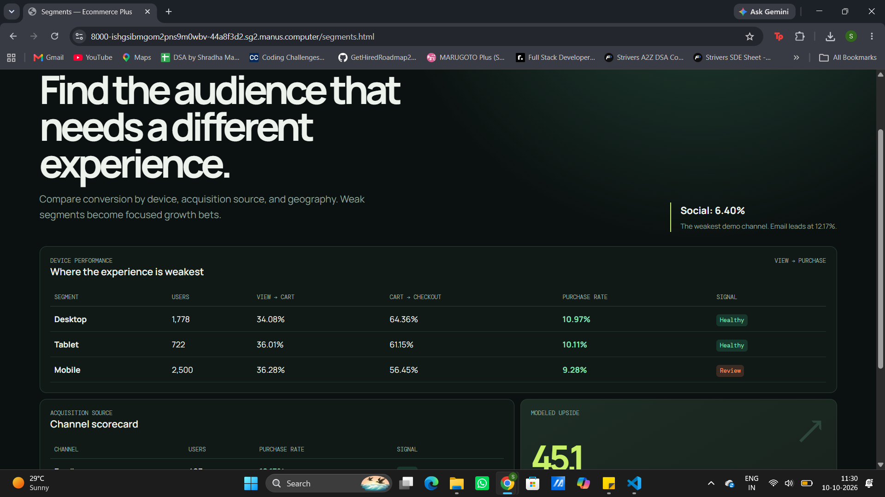

# E-Commerce Funnel Drop-off Analysis

A beginner-friendly project that explains **where online shoppers leave before buying**.

> The included data is **simulated** for learning and portfolio demonstration. It is not real customer data.

## Project in one sentence

This project follows a customer from **product view → add to cart → checkout → purchase**, calculates where customers drop off, compares customer groups, and shows the results in dashboards.

---

## 1. Problem

An online store may receive many visitors but only a few buyers. The business needs simple answers:

- Where are customers leaving?
- Is the mobile experience weaker than desktop?
- Which marketing source brings better customers?
- Which region performs best?
- What should the company investigate first?

The raw data contains individual customer actions, but raw rows alone do not clearly answer these questions.

## 2. Action

I built a complete analytics workflow:

1. Created a simulated e-commerce event dataset with Python.
2. Used Pandas to read, organize, and export the data.
3. Loaded the event data into SQLite.
4. Used SQL to create user-level funnel flags and calculate conversion rates.
5. Compared performance by device, traffic source, and region.
6. Exported summary tables for reporting.
7. Built interactive Tableau views and a browser dashboard.
8. Added an optional browser-based logistic regression model to estimate purchase propensity.

## 3. Result

The project produces:

- Funnel counts and conversion rates
- Drop-off percentages between stages
- Device, channel, and region comparisons
- Revenue and purchase summaries
- Opportunity estimates for weak segments
- Tableau dashboard assets
- A multi-page browser dashboard with CSV upload
- An explainable ML model with holdout validation

---

## Dashboard preview

### Overview

The Overview page shows the main KPIs, the complete journey map, the biggest opportunity, segment comparisons, and the data input area.



### Funnel page

The Funnel page focuses only on the customer journey and shows the largest stage-by-stage losses.




### Segments page

The Segments page compares devices, acquisition sources, and modeled opportunity by group.


### ML Model page

The ML Model page explains what the purchase-propensity model learns and how it should be interpreted.


### Data Studio page

The Data Studio page explains the CSV format and how a company can bring its own event data.


---

## How the funnel works

Think of the funnel like four rooms in a shop:

```text
Product view → Add to cart → Checkout start → Purchase
```

Many people enter the first room. Fewer people reach each next room.

### Example

```text
5,000 product viewers
1,773 add to cart
1,061 start checkout
500 purchase
```

### Main formulas

```text
View-to-cart rate       = add-to-carts / product views × 100
Cart-to-checkout rate   = checkout starts / add-to-carts × 100
Checkout-to-purchase    = purchases / checkout starts × 100
Overall purchase rate   = purchases / product views × 100
Drop-off rate           = 100 - conversion rate
```

For example:

```text
1,773 / 5,000 × 100 = 35.46% view-to-cart conversion
100 - 35.46%        = 64.54% view-to-cart drop-off
```

---

## What is in one event row?

One row represents one action performed by a customer.

Example:

| user_id | event_type | device_type | traffic_source | region | order_value |
|---|---|---|---|---|---:|
| U00001 | product_view | Mobile | Email | East | |
| U00001 | add_to_cart | Mobile | Email | East | |
| U00001 | checkout_start | Mobile | Email | East | |
| U00001 | purchase | Mobile | Email | East | 85.40 |

One user can have multiple rows because one user can perform multiple actions.

The SQL analysis converts these event rows into one user-level summary:

| user_id | viewed | added_to_cart | started_checkout | purchased |
|---|---:|---:|---:|---:|
| U00001 | 1 | 1 | 1 | 1 |

A `1` means the user completed that stage. A `0` means they did not.

---

## How the simulated data was created

The file `generate_funnel_data.py` creates the practice data.

It uses:

- Python's built-in `random` library for choices and probabilities
- Python's `datetime` library for event timestamps
- Pandas to create the final table and save the CSV

It creates:

- 5,000 simulated users
- User IDs and session IDs
- Product-view, cart, checkout, and purchase events
- Mobile, Desktop, and Tablet users
- Organic Search, Paid Search, Direct, Social, Email, and Referral sources
- North, South, East, West, and Central regions
- Electronics, Fashion, Home, Beauty, and Sports categories
- Order values between approximately $20 and $300
- Events spread over about 90 days

The script uses `random.seed(42)`. This makes the random data reproducible: running the script again creates the same sequence of choices.

The behavior is intentionally varied. For example, some traffic sources and devices receive small probability adjustments so the segment analysis has meaningful differences. These are simulated patterns, not claims about real customers.

### Important data note

The project does **not** use real company customer data. To analyze real data, upload a CSV with the required event format in the browser dashboard.

---

## Tools used

| Tool | Simple explanation | Used for |
|---|---|---|
| Python | Main programming language | Data generation and analysis scripts |
| Random | Makes controlled random choices | Simulated users and behavior |
| Datetime | Creates dates and times | Event timestamps |
| Pandas | Works with table data in Python | Reading, sorting, transforming, and exporting data |
| SQLite | Small file-based database | Storing the event table |
| SQL | Language for asking database questions | Funnel and segment calculations |
| Tableau | Business intelligence and visualization tool | KPI cards, funnel views, filters, and dashboards |
| JavaScript | Runs logic in the browser | CSV upload, calculations, interactions, and browser ML |

The original data-generation workflow does not directly import NumPy. Pandas may use NumPy internally, but the project does not need an explicit `numpy` import for the basic simulation.

---

## SQL logic in simple words

The main query uses conditional aggregation:

```sql
MAX(CASE WHEN event_type = 'purchase' THEN 1 ELSE 0 END)
```

This means:

- If a user has a purchase event, mark them as `1`.
- Otherwise, mark them as `0`.
- `MAX` makes sure one purchase event is enough to mark the user as a purchaser.

Then the query groups events by `user_id` and sums the flags to calculate the funnel counts.

The segment query repeats the same idea by grouping customers by:

- `device_type`
- `traffic_source`
- `region`

---

## KPIs in this project

KPI means **Key Performance Indicator**. A KPI is an important number connected to a business goal.

The project uses:

- **Unique users:** number of different customers
- **Product views:** users entering the funnel
- **Add-to-carts:** users showing purchase interest
- **Checkout starts:** users beginning payment
- **Purchases:** completed orders
- **Conversion rate:** percentage reaching the next stage
- **Drop-off rate:** percentage not continuing
- **Revenue:** total `order_value` from purchases
- **Average order value:** revenue divided by purchases

A metric is any measurable number. A KPI is a metric that matters especially to the business goal.

---

## Tableau dashboard

The packaged Tableau workbook is:

```text
dashboard/ecommerce_funnel_dashboard.twbx
```

A Tableau workbook is built from:

- **Data source:** the original table or file
- **Worksheet:** one chart or table
- **Dashboard:** multiple worksheets arranged together
- **Filter:** a control that limits the displayed data
- **Calculated field:** a formula made inside Tableau

The dashboard is arranged as:

1. KPI cards for the headline numbers
2. Funnel visualization for customer drop-off
3. Segment charts for devices, sources, and regions
4. Recommendations for what to investigate next

The dashboard helps a business user understand the story without reading Python or SQL code.

---

## Browser dashboard pages

The `dashboard` folder also contains a static multi-page website:

- `index.html` — Overview
- `funnel.html` — Funnel analysis
- `segments.html` — Segment comparison
- `model.html` — ML explanation
- `data-studio.html` — CSV requirements and data workflow
- `dashboard.js` — CSV parser, calculations, interactions, and model code

The browser dashboard can:

- Load the synthetic demo data
- Upload a company's CSV file
- Accept pasted CSV text
- Calculate funnel metrics locally
- Compare segments
- Train the browser model on the loaded data

Uploaded CSV data is processed in the browser in this prototype. It is not sent to a server by the dashboard code.

---

## ML extension

The website includes an optional supervised **logistic regression** model.

It predicts whether a user is likely to purchase based on:

- Add-to-cart behavior
- Checkout-start behavior
- A cart-plus-checkout interaction
- Device type
- Traffic source
- Region

Categorical values are converted into one-hot encoded features. The model uses regularization and a deterministic 80/20 train-test split. It reports:

- Holdout accuracy
- Balanced accuracy
- ROC-AUC
- No-purchase baseline
- Positive and negative model signals

The model is for directional prioritization. It does not prove causation or guarantee additional sales. The original resume project is primarily a Python, Pandas, SQL, SQLite, and Tableau analysis; the browser ML model is an extension of the project.

---

## Folder structure

```text
.
├── analysis/
│   ├── funnel_analysis.py
│   ├── segment_analysis.py
│   ├── opportunity_analysis.py
│   └── conversion_confidence_interval.py
├── data/
│   ├── ecommerce_user_events.csv
│   ├── funnel_summary_metrics.csv
│   ├── segment_funnel_metrics.csv
│   └── opportunity_priorities.csv
├── dashboard/
│   ├── index.html
│   ├── dashboard.js
│   ├── funnel.html
│   ├── segments.html
│   ├── model.html
│   ├── model.css
│   ├── data-studio.html
│   └── ecommerce_funnel_dashboard.twbx
├── sql/
│   ├── funnel_conversion_analysis.sql
│   └── segment_funnel_analysis.sql
├── ecommerce_funnel.db
├── generate_funnel_data.py
├── load_to_sqlite.py
└── README.md
```

---

## Run the Python workflow

Install the requirements:

```bash
pip install -r requirements.txt
```

Generate the simulated data:

```bash
python generate_funnel_data.py
```

Load the CSV into SQLite:

```bash
python load_to_sqlite.py
```

Run the analysis scripts:

```bash
python analysis/funnel_analysis.py
python analysis/segment_analysis.py
python analysis/opportunity_analysis.py
```

The output tables are saved in the `data` folder.

---

## Run the browser dashboard

From the `dashboard` folder:

```bash
python3 -m http.server 8000 --bind 0.0.0.0
```

Then open:

```text
http://localhost:8000/index.html
```

For a static deployment, upload the complete `dashboard` folder to Netlify, Vercel, GitHub Pages, or Cloudflare Pages.

---

## Limitations

- The included data is simulated.
- The analysis is mainly user-level, not a strict session-level funnel.
- Patterns show association, not causation.
- Opportunity estimates are directional.
- Real data needs tracking validation, missing-value handling, duplicate checks, and privacy controls.
- Small segments can have unstable conversion rates.
- A real company should validate recommendations with experiments such as A/B tests.

---

## Interview-ready explanation

> I created a simulated e-commerce event dataset with Python, used Pandas for table preparation, loaded the data into SQLite, and used SQL conditional aggregation to turn event rows into user-level funnel flags. I calculated stage conversion rates and drop-offs, compared device, traffic-source, and regional segments, and built Tableau dashboards with KPI cards, funnel views, filters, and recommendations. The dataset is simulated, so it demonstrates the analysis workflow rather than representing real company performance.
